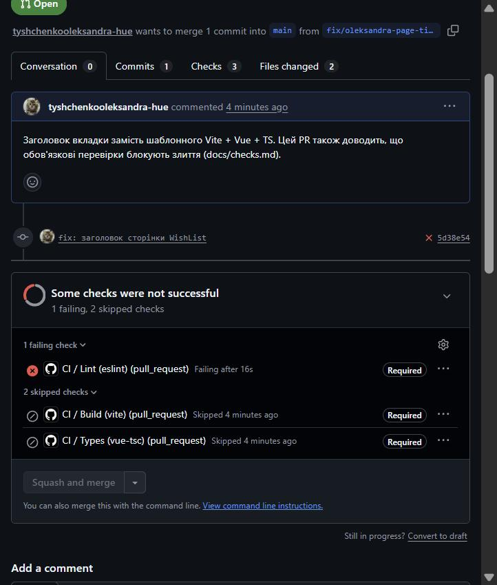
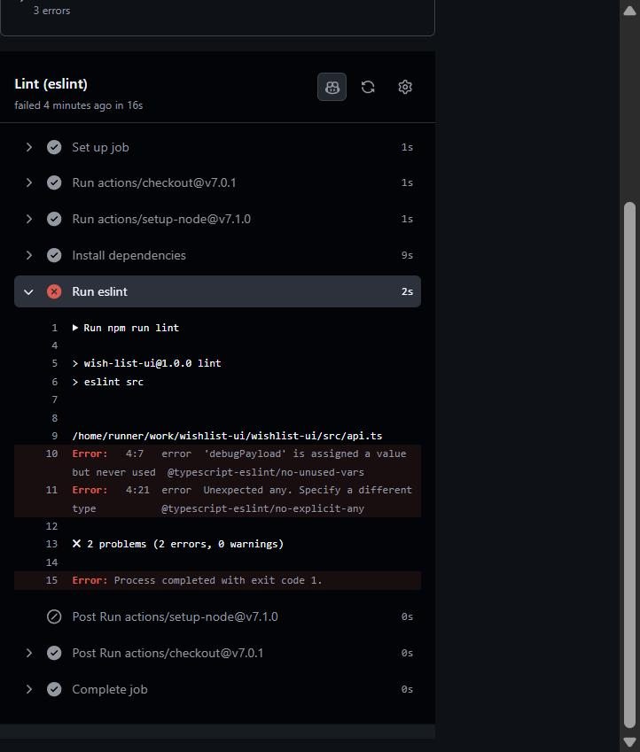
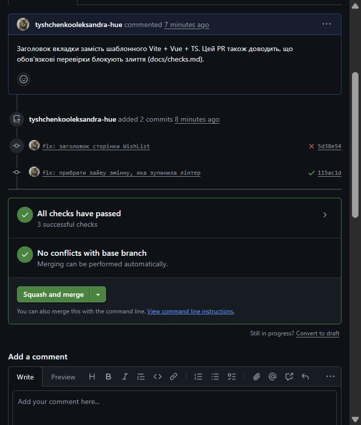

# Перевірки конвеєра: wishlist-ui

## Обов'язкові перевірки блокують злиття

Ruleset `protect-main` вимагає `Lint (eslint)`, `Types (vue-tsc)` і `Build (vite)`.
Доказ — [PR #2](https://github.com/tyshchenkooleksandra-hue/wishlist-ui/pull/2): у першому коміті навмисно залишено зайву змінну з типом `any`.

**1. Червона перевірка, кнопка злиття заблокована.** Лінтер упав, тому типи й збірка пропущені.

**2. Журнал із конкретним рядком помилки:** `src/api.ts 4:21 error Unexpected any`.

**3. Той самий PR після виправлення:** усі перевірки зелені, кнопка активна.

## Ефект кешу

| Прогін | Час |
|---|---|
| Без кешу (перший прогін PR #1) | 106 с |
| З кешем (повторний прогін того самого PR) | 50 с |

Найдовший крок — `Install dependencies` (`npm ci`): 47 с без кешу, 4 с із кешем.
